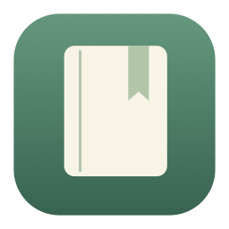
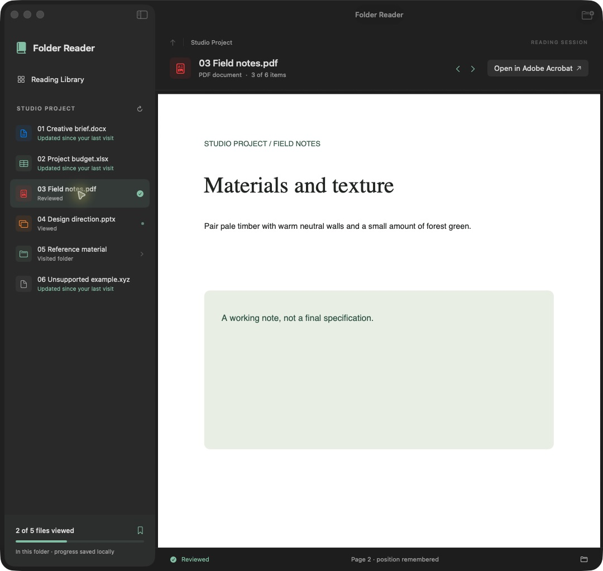

  

<h1 align="center">Folder Reader</h1>

<strong>A bookmark for the whole folder.</strong> 
Read documents, spreadsheets, presentations, and media in one native Mac window. Come back to the file—and PDF page—you left behind.

  <a href="https://github.com/rcox-shome/folder-reader-releases/releases/tag/v0.1.2">Download experimental preview</a> ·
  <a href="#what-it-does">Features</a> ·
  <a href="https://github.com/rcox-shome/folder-reader-releases/issues/new?template=feedback.yml">Share feedback</a>

*Actual v0.1.2 interface with fictional sample documents.*

## Try the preview

**v0.1.2 · Apple silicon · macOS 14 or later**

This is an early experimental app. The download is ad-hoc signed, **not Developer ID signed or notarized**. It is currently unsandboxed. macOS may block its first launch; read the [installation notes](INSTALL.md) before downloading. Intel builds are not included.

[Download FolderReader-0.1.2-macOS-arm64.zip](https://github.com/rcox-shome/folder-reader-releases/releases/download/v0.1.2/FolderReader-0.1.2-macOS-arm64.zip)

## What it does

- **One folder, one reading window.** Move through mixed files with a sidebar and previous/next controls.
- **Pick up where you left off.** Resume recent folders and restore the selected file. PDFs remember the last page.
- **Separate viewed from reviewed.** Automatic viewed marks and explicit reviewed marks help you track progress. A changed file resets its previous status.
- **Notice changes.** New and updated badges appear when a visited directory is scanned again.
- **Start in Finder.** Right-click a folder and choose **Open in Folder Reader**.
- **Keep your originals.** Open a file in its default app or reveal it in Finder at any time.

PDFs use PDFKit; video and audio use AVKit. Documents, spreadsheets, presentations, images, and text use macOS Quick Look. Preview support depends on the format and installed providers.

## A small workflow

1. Open a folder, drop one into the app, or use the Finder service.
2. Read through its files. Use **Option–Command–Left / Right** to move between them.
3. Mark a file **Reviewed** with **Shift–Command–R**.
4. Return later and choose **Resume** from the Reading Library.

## Local by design

Folder Reader has no backend, account system, analytics, or document-upload functionality. It does not edit your source documents. Reading history—including file paths, review status, bookmarks, and PDF page numbers—is saved on your Mac. Cloud storage providers may download online-only files when you preview them.

[Privacy and local storage](PRIVACY.md)

## Where the prototype stands

Version 0.1.2 fixes a Finder service startup issue so the reader window comes forward when the app is launched from a folder.

The release-mode build and 11 core tests passed on Apple silicon. The packaged app was opened with sample documents and its PDF preview inspected. This is not exhaustive compatibility testing.

Current limits:

- Office worksheet, cell, and slide positions are not remembered. PDF memory is page-level.
- The system spreadsheet preview can lose its worksheet tabs after following a worksheet link.
- Moved or renamed files are treated as new paths.
- Progress covers files directly inside the current folder; subfolders have separate records.
- Change detection runs on folder entry, refresh, and app activation—not as a continuous background scan.
- Large folders, cloud placeholders, external drives, and a broad range of macOS versions need more testing.
- Production signing, notarization, and sandboxing are still ahead.

## Feedback

[Report a bug](https://github.com/rcox-shome/folder-reader-releases/issues/new?template=bug-report.yml) or [describe your reading workflow](https://github.com/rcox-shome/folder-reader-releases/issues/new?template=feedback.yml). Include the app version, macOS version, file type, and steps to reproduce. Use fictional examples; avoid posting private documents or full local paths.

---

Built by [Reese Cox](https://github.com/rcox-shome) with Swift, SwiftUI, and AppKit.

This repository contains the public showcase, documentation, and packaged previews. **The application source remains private.**
